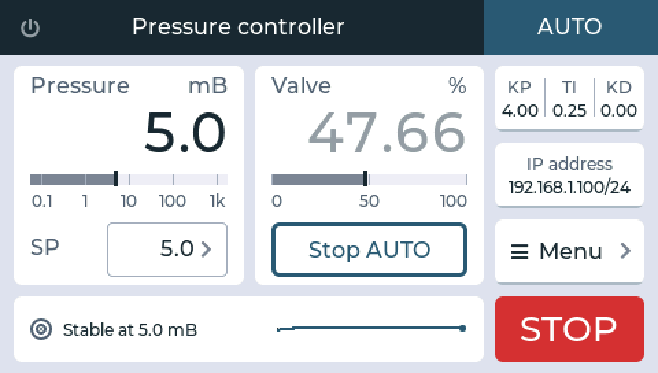

# MercShore iPC Pressure Controller

A pressure-based needle-valve controller for helium-flow cryostats.

Oxford Instruments cryostats (CF-10, CF-11, HM-2, AVM-1, AVM-2) draw helium through a needle valve driven by a geared stepper motor. The controller holds the pressure measured by a Druck transducer on the pumping line by moving that valve. It keeps the cryostat's existing transducer and valve.

Pressure is a rough proxy for the helium flow. The flow itself is not measured.

## At a glance

| | |
| --- | --- |
| Controller | MikroE Mikromedia 4 (STM32F407ZG) with four Click boards. Bought modules only |
| Operation | 4.3 in touchscreen: MANUAL (valve position in %) and AUTO (pressure held at a setpoint) |
| Pressure | Shown to 0.1 mbar. Typical setpoints are 1 to 25 mbar |
| Remote access | A text command port on TCP 8888 and Modbus TCP on port 502, over Ethernet |
| Closing stop | The valve's limit switch, read in firmware. There is no hardware interlock |
| Firmware | 0.18.0, tested on the board, on a bench cryostat |

## Contents

- [Repository](#repository)
- [Documents](#documents)
- [Hardware](#hardware)
- [Quick start](#quick-start)
- [Licence](#licence)

## Repository

| Folder | Holds |
| --- | --- |
| `firmware/` | The firmware: a NECTO Studio 7 project on the mikroSDK with LVGL 9.4 |
| `docs/` | The documents below, the screen captures and the hardware schematics and wiring |
| `simulator/` | The firmware compiled to WebAssembly, run in a browser over a simulated bench |
| `secop/` | A Frappy (SECoP) driver for the text port |
| `tools/` | A Lake Shore 336 logger, the PC tests, the screen previews and a cross-build |

## Documents

**To operate the controller**

| Document | Covers |
| --- | --- |
| [Operation manual](docs/operation-manual.md) | Power-up, homing, MANUAL and AUTO, calibration, faults and warnings, settings, remote access, maintenance |
| [Screens](docs/screens/README.md) | A capture of every screen |

**To connect to it**

| Document | Covers |
| --- | --- |
| [Text port commands](docs/text-port-commands.md) | The text port on TCP 8888: commands, replies and error codes |
| [Modbus register map](docs/modbus-register-map.md) | The Modbus TCP server on port 502: registers, coils and exceptions |
| [Frappy driver](secop/README.md) | The SECoP driver and its tests |

**To build and change it**

| Document | Covers |
| --- | --- |
| [Firmware](docs/firmware.md) | Boards, connections and socket pins, firmware structure, pressure measurement, storage, build and flash |
| [Hardware documents](docs/hardware/README.md) | Board schematics and the wiring drawings |
| [Simulator](simulator/README.md) | Running and rebuilding the simulator, and its tests |
| [Tools](tools/README.md) | Each PC tool and test, and how to run it |
| [Contributing](CONTRIBUTING.md) | Branches, versions and the checks before a merge |

## Hardware

| Board | Where | What it does |
| --- | --- | --- |
| Mikromedia 4 for STM32 Capacitive, with the Mikromedia 4 Capacitive Shield | Main board and its socket shield | Runs the firmware. Touchscreen, Ethernet, serial flash, real-time clock |
| Adapter Click | Socket S1 | Carries the Pressure 21 Click and brings out the limit switch input |
| Pressure 21 Click | On the Adapter Click | Room pressure, for the air point of the calibration |
| Stepper 3 Click | Socket S2 | Drives the valve's unipolar stepper motor |
| Boost 10 Click | Socket S3 | 10 V excitation for the Druck transducer |
| Power Monitor Click | Socket S4 | Reads the Druck output and the excitation |

Off the board:

- The Druck UNIK 5000 transducer, 15 psia absolute.
- The Oxford Instruments needle valve, with its geared stepper and limit switch.
- A PoE splitter giving a regulated 12 V.

Connections, pins and cautions are in [`docs/firmware.md`](docs/firmware.md).

## Quick start

**Try it without hardware.** Open `simulator/index.html` in a browser. It runs the same firmware source as the board. See [`simulator/README.md`](simulator/README.md).

**Build and flash.** Open `firmware/` in NECTO Studio 7, build Debug, and flash over USB-C with mikroBootloader. See [`docs/firmware.md`](docs/firmware.md).

**Connect.** The controller has a static IP address, 192.168.1.100/24 unless it is changed on Menu > System.

| Port | Service |
| --- | --- |
| TCP 8888 | Text commands |
| TCP 502 | Modbus TCP |

**Run the tests.** [`tools/README.md`](tools/README.md) lists the PC tests, and [`simulator/README.md`](simulator/README.md) the simulator's.

## Licence

The project's own files are under the Apache License 2.0 (`LICENSE`, `NOTICE`).

The repository also holds third-party software and documents under their own licences, and the firmware image links the mikroSDK. Read [`THIRD-PARTY-NOTICES.md`](THIRD-PARTY-NOTICES.md) before building or distributing it.
