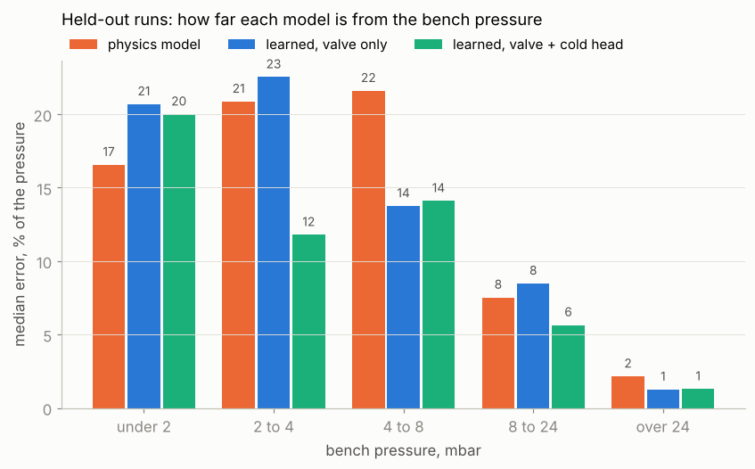

# Learned fit of the cryostat's pressure response

Machine learning on the bench session logs: does a model trained on the logs predict the pressure from the valve moves better than the simulator's bench cryostat (`../wasm/bench.c`, the "physics model" below)? Checked only on runs the learned model never saw.

```
python3 fit.py <folder of pmc_session_*.csv> [--out results]
```

Needs numpy, scikit-learn and matplotlib (`tried/` also needs torch). Takes about 5 min the first time (it caches the physics runs in `results/features.pkl`). The session logs themselves are not in the repository.

## Result (15 logs, 5 to 10 Nov 2026)

**On the valve alone, the learned model ties the physics model. Given the cold head temperature as well, it is about 10 % better overall, and clearly closer between 2 and 8 mbar (12 to 14 % off instead of 21 to 22 %). Under 2 mbar there is no gain.**

Median error of the pressure on held-out runs, as a percentage of the pressure (rms in mbar in brackets). Cryostat cold (heat exchanger under 20 K), 70,216 one-second samples:

| Bench pressure, mbar | Physics model | Learned, valve only | Learned, valve + cold head |
|---|---|---|---|
| under 2 | 17 % (0.78) | 21 % (0.83) | 20 % (0.74) |
| 2 to 4 | 21 % (1.11) | 23 % (1.01) | 12 % (0.87) |
| 4 to 8 | 22 % (1.41) | 14 % (1.20) | 14 % (1.07) |
| 8 to 24 | 8 % (1.18) | 8 % (1.43) | 6 % (1.21) |
| over 24 | 2 % (3.35) | 1 % (2.62) | 1 % (2.61) |
| all | 8 % (1.46) | 10 % (1.47) | 6 % (1.31) |



Given the logged heat exchanger temperature too (the physics model then runs on it as well), the learned model is at 5 % (1.39 mbar) against 6 % (1.90 mbar). `results/results.txt` has every run and every variant; `results/held-out-<date>-<time>.png` draws each run with the model that was trained without it.

What the logs say beyond the scores:

- **The valve's zero moves between sessions, and that matters more than the choice of model.** The valve position where the pressure takes off shifted by -0.60 % (5 Nov), 0 (9 Nov), +0.45 % (10 Nov morning) and +0.55 % (10 Nov afternoon). The whole climb from 1 to 10 mbar spans about 0.5 % of travel. Without the shift, the physics model is 4.2 mbar off overall; with it, 1.5 mbar. Both models are given this one number per run.
- **The physics model holds up on a run it was not fitted to.** The 10 Nov afternoon autotune (1 to 24 mbar) arrived after bench.c's numbers were set: 1.03 mbar rms with the shift.
- **The cold head temperature carries information the valve does not.** It is the one extra input that improves the held-out scores, most likely because it follows how much liquid reaches the needle.
- **Under 2 mbar the error is the needle, not the model.** In the 10 Nov 1 mbar relay the same opening move lifted the pressure after 19, 27 and 88 s. No model reading the valve can predict which.

## How it works

`logs.py` reads the CSVs. The GUI saves its last 4 h, so saves a few minutes apart share samples: 169,080 rows hold 89,719 different samples. They are cut into runs (no gap over 5 s, MANUAL or AUTO), and runs less than an hour apart are held out together: 8 groups.

`physics.py` runs bench.c's model on a logged valve (through `../wasm/fit_bench.py`, same numbers), finds each run's valve offset, and builds what the learned model reads each second: the valve, the needle after the opening stick, how far the valve is from its own average over the last 5 s to 33 min, the time since the last opening and closing move, how much it travelled in the last 1 and 10 min, and the physics model's own pressure and heat exchanger temperature.

`fit.py` trains the learned model and scores it. The learned model is the physics model times a correction: gradient-boosted trees (scikit-learn, 200 trees of depth 4) that predict the factor the bench pressure is off the physics by. No correction is the physics model itself, so it cannot go far wrong where it has no data. Each group of runs is left out in turn; the trees are trained on the other seven and scored on the one left out. Their settings were fixed before the first score and not tuned on the held-out runs.

Rules of the comparison:

- Both models get the logged readings for the first 2 min of a run and the valve alone after that. The first 10 min are not scored.
- Both get the same valve offset for the run, the one that makes the physics model fit the whole run best. This uses the held-out run for one number, and it is chosen to suit the physics model.
- Only samples with the heat exchanger under 20 K count, for training and for scores. bench.c does not describe the warm restarts of 5 and 6 Nov.
- The physics model's numbers were set by hand on the 6, 9 and 10 Nov morning logs, so for it those runs are not unseen. Only the 10 Nov afternoon run is entirely new to it.

## Tried and dropped

Both are in `tried/`, with what they scored in their headers.

- `gru.py`: a free-form recurrent network that reads the valve and predicts the pressure, the heat exchanger and the cold head. It fits the training runs to a few percent and the left-out 9 Nov 11:45 run to 1.9 to 5.4 mbar (physics 1.1). Five recordings to train on are too few for it: it memorises them.
- `grey.py`: bench.c's equations with every table trainable by gradient descent through the simulation. Untrained it is the physics model; trained, it got worse on the left-out run (2.2 mbar against 1.1), because the tables bend to fit the warm restarts.

## Limits

- The correction reads the physics model's state but does not feed back into it, so it cannot change how the heat exchanger evolves.
- It is a Python model. It is not in the simulator page; putting it there means porting 200 small trees to C, and the valve-only version would gain nothing.
- Eight groups of runs from one cryostat over five days. Each new log changes the scores; rerun `fit.py` on the folder with the new log added.
